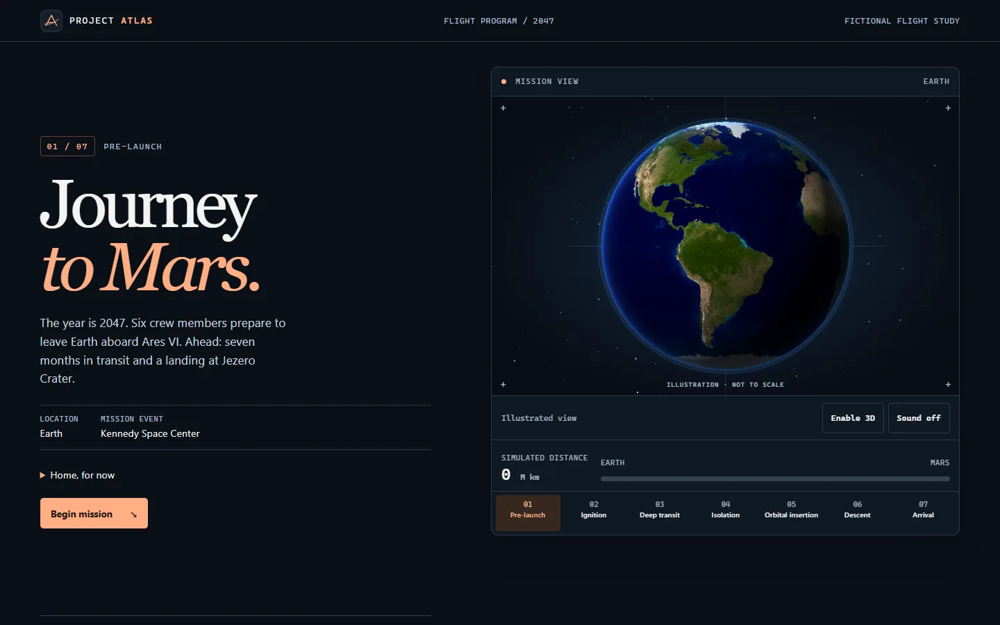

# Project Atlas · 2047

Project Atlas is a fictional mission from Earth to Jezero Crater. Scroll through seven chapters, jump to a mission phase, or explore the Earth, Moon, astronaut, and Mars in an optional 3D viewport. The console shows simulated distance traveled in the story; it does not ingest live telemetry.



- Read the entire mission with JavaScript disabled. Native links and expandable mission notes still work.
- Enable 3D to inspect the current phase. Illustrations stay visible while models load and return if WebGL or a model fails.
- Enable ambient sound independently. The viewport and audio respect tab visibility; the viewport also respects reduced motion.

## Develop locally

Use Node.js 22 or later. No environment variables, API keys, backend, or external CDN are required.

```sh
npm ci
npm run build
npm start
```

Open `http://127.0.0.1:4173`. The preview serves the production build; rebuild after changing source files. Set the optional `PORT` environment variable to use a different local port.

```sh
npx playwright install chromium
npm test
npm audit
```

The browser tests cover desktop keyboard navigation, phase links, telemetry, sound controls, mobile deep links and touch, 3D model loading and retry, and navigation without JavaScript. To use an installed Chrome instead of Playwright's browser, set `ATLAS_BROWSER=chrome` before running the tests.

## Code and assets

| Path | Responsibility |
| --- | --- |
| `index.html` | Mission chapters, phase destinations, and the simulated distance at each phase |
| `css/style.css` | Responsive story and console layout, design tokens, and motion preferences |
| `js/main.js` | Active phase, telemetry, viewport mode, and visibility coordination |
| `js/scene.js` | Lazy Three.js renderer, model loading, framing, and resource disposal |
| `js/sound.js` | User-initiated ambient audio generated with Web Audio |
| `assets/`, `models/` | Illustrations, icons, and optimized glTF models |
| `scripts/`, `test/` | Static build, preview server, asset preparation, and browser tests |

esbuild creates a small entry point and an independent 3D chunk. Phase changes request only the needed models; the viewer cancels stale fetches and releases resources for the previous model family. It redraws planets on scroll or resize and runs a continuous animation loop only for the astronaut, while visible and with motion enabled. The viewport also caps pixel density and total pixels to limit GPU work.

Compared with commit `8961c57`, the opening page went from preloading **45.51 MB** of GLB files to requesting **zero** GLB bytes by default. The initial illustrated page uses about **85 KB** of uncompressed local resources in a cold Chromium load. The original six runtime models total **74.34 MB**; the four optimized models total **12.09 MB**, with the satellite and Voyager generated in code. The optional 3D chunk is about **789 KB** uncompressed. These are payload measurements; they do not predict frame rate or Core Web Vitals.

[Asset credits and license terms](ASSET-CREDITS.md) cover the models and illustrations. To reproduce the texture optimization, use Pillow and pass a directory containing the original source GLBs to `python scripts/prepare-art.py <source-directory>`. The astronaut needs a subsequent glTF Transform `metalrough` pass and `meshopt --level medium` pass. Use separate intermediate files, then replace `models/astronaut-scene.glb` with the packed result. The historical source binaries remain in Git history.

## Deploy

Publish the contents of `dist/` to any static host after `npm ci && npm run build`. Serve the site over HTTPS and keep the relative paths intact. For GitHub Pages, set **Settings → Pages → Source** to **GitHub Actions**. The checked-in workflow installs dependencies, runs browser tests, and deploys the built artifact from `main`. Pull requests run the checks without publishing. The workflow has to be enabled in the repository before it can deploy.
